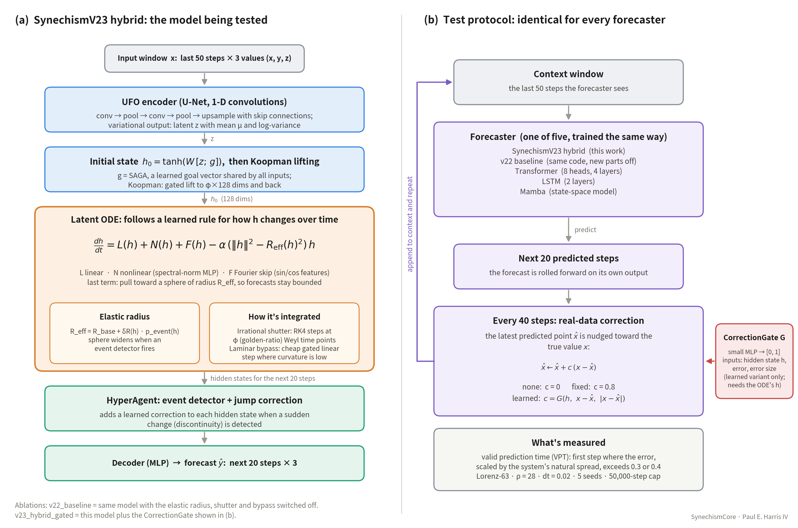

> **Status: work in progress.** Floor-free results for Experiments 3 and 4 are being run. The numbers below are early and floor-limited.

# SynechismCore

**Does a chaotic forecaster's architecture still matter once you keep correcting it with real data?**
Paul E. Harris IV · Independent Researcher, Mashantucket Pequot Nation
MIT License · Target: arXiv preprint, then a 2027 workshop

---

## Overview

Chaotic systems (weather, turbulence, many physical processes) can't be forecast far ahead: tiny errors grow until the forecast is useless. One standard fix is to feed real observations back into the forecast every so often, which pulls it back on track.

This project asks whether, once that correction is in place, the design of the forecasting model still makes a difference. It compares a Latent Neural ODE (SynechismCore, this repo) against Transformer, Mamba and LSTM forecasters, all given the identical correction, and tests whether a learned correction gate does better than a simple fixed blend.

The current experiments use the Lorenz-63 system. Scope details: [`PAPER_SCOPE.md`](PAPER_SCOPE.md).

---

## Architecture



**(a) The model being tested: SynechismV23 hybrid.** An encoder turns the last 50 observed steps into a starting hidden state. A latent neural ODE then evolves that state forward smoothly, with an elastic attractor term that keeps forecasts bounded, golden-ratio (φ) time steps, and a cheap shortcut through calm stretches. A HyperAgent corrects sudden jumps, and a decoder turns the hidden states into a 20-step forecast.

**(b) How every model is tested.** Five forecasters (SynechismV23 hybrid, the v22 ablation baseline, Transformer, LSTM and Mamba) are rolled forward on their own predictions. Every 40 steps the latest prediction is nudged toward the true value: not at all, by a fixed 0.8, or by a learned gate (SynechismV23 only). Accuracy is the number of steps until the forecast first goes wrong (valid prediction time, VPT).

Full description, component table, ablation variants and baselines: [`docs/ARCHITECTURE.md`](docs/ARCHITECTURE.md). The same diagram, in text form, is at the top of [`src/v23_components.py`](src/v23_components.py).

---

## Results so far (Lorenz, 5 seeds, floor-limited)

Steps until divergence under the rolling-window coherence metric, seeds 0–4
(from [`results/periodic_correction_5seed_summary.md`](results/periodic_correction_5seed_summary.md)).

| Condition | Mean ± Std (steps) | Seed 0 | Seed 1 | Seed 2 | Seed 3 | Seed 4 |
|---|---|---|---|---|---|---|
| v23_hybrid_zero (no correction) | 384.0 ± 8.9 | 380 | 400 | 380 | 380 | 380 |
| v23_hybrid_fixed (fixed c = 0.8) | 464.0 ± 75.4 | 380 | 580 | 420 | 480 | 460 |
| v23_hybrid_gated (learned gate) | 396.0 ± 26.1 | 380 | 400 | 440 | 380 | 380 |
| v22_baseline_fixed (fixed c = 0.8) | 448.0 ± 87.9 | 600 | 400 | 440 | 420 | 380 |

**Floor note:** this metric cannot report anything below 380 steps (it needs 20 full windows of 20 steps before it can flag divergence), so values of exactly 380 are floor-limited, not measured. 9 of the 20 values sit on the floor.

**What this shows so far:** fixed correction lifts 4 of 5 runs above the floor, compared with 1 of 5 with no correction. Whether the learned gate helps can't be judged yet, because most of its runs sit on the floor.

Earlier versions of this project (v17–v23) benchmarked other systems on free Kaggle GPUs and reported a long-horizon result using a coherence metric later found to be flawed. Those results are not part of this paper and have been removed from the repo.

## Next

1. **Floor-free accuracy measure.** First-crossing valid prediction time (VPT) at error thresholds 0.3 and 0.4, recorded per step, with censoring. Added to the code; being run.
2. **Experiment 3, head-to-head.** Latent Neural ODE vs Transformer, Mamba and LSTM under identical correction.
3. **Experiment 4, gate retrain.** The learned gate trained across full correction cycles, logging what it outputs.
4. **More systems** (Kuramoto–Sivashinsky, weather, robotics). These need new coherence-test code; scope decided at the budget checkpoint.
5. **Write-up.** arXiv preprint, then a 2027 workshop submission.

---

## Repository

```
SynechismCore/
├── run_v23_benchmark.py     # Coherence tests: Experiments 3 and 4 (and the earlier correction test)
├── src/
│   ├── v23_components.py    # SynechismV23 (Latent Neural ODE) and CorrectionGate
│   ├── models.py            # SynechismV20 (v22 baseline), FairTransformer, FairLSTM, FairMamba
│   ├── chaotic_metrics.py   # Forecast metrics
│   ├── data.py              # Data generators (Lorenz-63 and others)
│   ├── train.py             # Training loops
│   ├── stats.py             # Significance tests
│   ├── quantum_lattice.py   # φ-scaled time lattices used by the models
│   ├── hyperagent.py        # Optional event detector + jump correction
│   ├── hyevo.py             # Hyperparameter search (not used by the current experiments)
│   └── __init__.py
├── docs/
│   ├── ARCHITECTURE.md        # Model and test-protocol description (paper-ready)
│   ├── architecture_v23.png   # Figure 1 (also .svg)
│   └── make_architecture_figure.py
├── results/
│   └── periodic_correction_5seed_summary.md
├── PAPER_SCOPE.md           # What the paper covers, what's done, what's out of scope
└── requirements.txt
```

Coherence runs write their output to `results/coherence/` (created on first run).

---

## Running the Experiments (Paperspace A100)

The experiments run on a rented **Paperspace** machine with **1× A100**. Check the current hourly rate in the Paperspace console before starting.

**Billing:** the machine bills while it's running. **Stop** it when you're done for the day; that ends GPU billing and keeps your disk and files (storage may still be billed). Only delete the machine when the project is finished.

### 1. Start the machine and get the code

Start the machine in the Paperspace console and open a terminal on it. Then:

```bash
cd ~
git clone https://github.com/seek-k-nowledge/SynechismCore.git   # first time only
cd SynechismCore
git pull                                                          # every time
pip install -r requirements.txt
python -c "import torch; print(torch.cuda.is_available(), torch.cuda.get_device_name(0))"
```

The last line should print `True` and the GPU name. If it prints `False`, stop here (see Troubleshooting).

### 2. Use screen for anything long

`screen` keeps a run going if your laptop sleeps or the connection drops.

```bash
screen -S synechism
```

Detach (leave it running): `Ctrl+A`, then `D`. Reattach later: `screen -r synechism`.

### 3. Smoke test (once, a few minutes)

```bash
python -u run_v23_benchmark.py --coherence-head-to-head --seeds 42 --max-steps 500 2>&1 | tee smoke_exp3.txt
python -u run_v23_benchmark.py --coherence-gate-retrain --seeds 42 --max-steps 500 2>&1 | tee smoke_exp4.txt
```

Both should finish without errors and print a first-crossing VPT summary. If either fails, don't start the full runs.

### 4. Experiment 3: head-to-head under identical correction

```bash
python -u run_v23_benchmark.py --coherence-head-to-head --seeds 0 1 2 3 4 --max-steps 50000 2>&1 | tee run_log_exp3.txt
```

### 5. Experiment 4: gate retrain across full correction cycles

```bash
python -u run_v23_benchmark.py --coherence-gate-retrain --seeds 0 1 2 3 4 --gate-n-cycles 5 --max-steps 50000 2>&1 | tee run_log_exp4.txt
```

> **Always pass `--max-steps 50000`.** It sets how many steps each forecast is run for. The default is 1,000,000, and a run that never diverges would keep going all the way, costing hours of GPU time.

**How long:** an earlier estimate was about 6 hours for Experiment 3 and 7–8 hours for Experiment 4. Runs now continue until the floor-free VPT crosses its threshold or the 50,000-step cap is reached, so they can take longer. The log prints a step count and steps/sec every 1,000 steps; use that to judge.

### 6. Save the results, then Stop the machine

Each run writes:

| File | Contents |
|---|---|
| `run_log_exp3.txt`, `run_log_exp4.txt` | Full console output |
| `results/coherence/coherence_head_to_head_results.json` | Experiment 3: every run, plus summaries |
| `results/coherence/coherence_gate_retrain_results.json` | Experiment 4: every run, gate values, plus summaries |
| `results/coherence/error_series/` | Per-step error for every run (`.npy`) |

Copy the logs and the whole `results/coherence/` folder off the machine (for example with the Jupyter or file-browser download, or `scp -r` from your laptop), check they opened, then **Stop** the machine.

### Troubleshooting

| Problem | What to do |
|---|---|
| `torch.cuda.is_available()` prints `False` | The machine has no GPU attached or the wrong image. Check the machine type in the console. |
| `CUDA out of memory` | Stop the run, restart the machine, and run one experiment at a time. |
| `ModuleNotFoundError` | Run `pip install -r requirements.txt` again. |
| Connection dropped | Reconnect, then `screen -r synechism`. The run keeps going inside screen. |
| A run seems stuck | Check the latest step line in the log. If steps/sec is still moving, it's working. |

---

## What Results Go in the Paper

The paper's results come from `results/coherence/` (Experiments 3 and 4), reported with the floor-free first-crossing VPT as the main measure and the rolling-window metric alongside it.

Every result gets reported, including:
- **censored runs** (forecasts that never crossed the error threshold within 50,000 steps), reported as lower bounds, not dropped;
- results that don't favor the Latent Neural ODE;
- the learned gate, whether or not it beats the simple fixed blend.

---

*SynechismCore · Paul E. Harris IV · Independent Researcher · October 2026 · MIT License*
