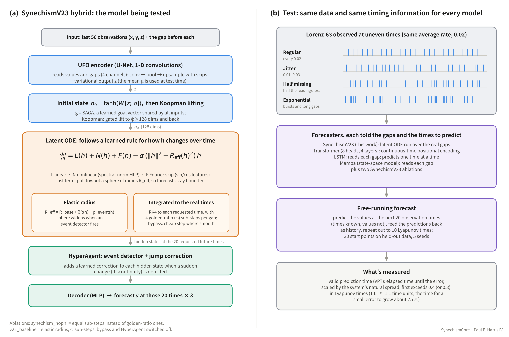
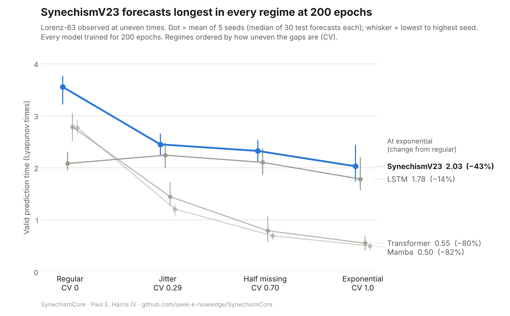

> **Status:** main comparison complete (every model trained 200 epochs, 4 sampling regimes, 5 seeds). Paper draft in progress; ablations at 200 epochs and extra baselines are next.

# SynechismCore

**Can a continuous-time model keep chaotic forecasts accurate when data arrives at uneven times?**
Paul E. Harris IV · Independent Researcher, Mashantucket Pequot Nation
MIT License · Target: arXiv preprint, then a 2027 workshop

---

## Overview

Real-world data rarely arrives on a clock. Robot sensors drop readings, headset frame rates wobble, weather stations lose connection, and event logs come in bursts. A world model that forecasts from that data has to cope with uneven gaps.

Most sequence models step once per observation, as if readings were evenly spaced. The Transformer (the architecture behind ChatGPT), the LSTM and Mamba-style state-space models all work this way, even when they're given the gaps as extra input. **SynechismCore** is a latent neural ODE: it evolves a hidden state continuously in time, so it can be run forward over any gap, short or long.

This project compares SynechismV23 against Transformer, LSTM and Mamba forecasters on the chaotic Lorenz-63 system observed under four sampling regimes. All four regimes have the same average rate but increasingly uneven timing. Every model gets the same data and the same timing information, and we measure how long each model's free-running forecast stays accurate.

Full experiment description: [`docs/IRREGULAR_TIMING.md`](docs/IRREGULAR_TIMING.md). Scope: [`PAPER_SCOPE.md`](PAPER_SCOPE.md).

---

## Architecture and test



**(a) SynechismV23 hybrid.**
- **Encoder:** turns the last 50 observations, and the gap before each one, into a starting hidden state.
- **Latent ODE:** evolves that state to each requested future time. It uses an elastic attractor term that keeps forecasts bounded, golden-ratio (φ) sub-steps inside each gap, and a cheap shortcut through smooth stretches.
- **HyperAgent:** corrects sudden jumps.
- **Decoder:** turns the hidden states into forecasts.

**(b) The test.** Every forecaster is told the past gaps and the future times it must predict. It runs forward on its own predictions, and accuracy is the valid prediction time (VPT) in Lyapunov times.

Component details: [`docs/ARCHITECTURE.md`](docs/ARCHITECTURE.md).

---

## Results (Lorenz-63, 5 seeds, every model trained 200 epochs)



The table shows mean valid prediction time in Lyapunov times. Each value is the mean of 5 seeds, and each seed's value is the median of 30 test forecasts. Higher is better.

| Model | Regular | Jitter | Half missing | Exponential |
|---|---|---|---|---|
| **SynechismV23** | **3.55** | **2.45** | **2.32** | **2.03** |
| LSTM | 2.08 | 2.24 | 2.10 | 1.78 |
| Transformer | 2.79 | 1.44 | 0.79 | 0.55 |
| Mamba | 2.77 | 1.20 | 0.69 | 0.50 |

**What this shows:** with every model trained to convergence, SynechismV23 forecasts longest in every regime.
- **Against the Transformer and Mamba:** it wins 5 of 5 seeds in every regime. Under exponential sampling it lasts about 4× as long; both lose about 80% of their VPT from regular to exponential sampling.
- **Against the LSTM, the strongest baseline:** it wins 5 of 5 seeds under regular sampling. Under uneven sampling the lead is smaller but consistent: 4 of 5 seeds per regime, 9–14% longer on average, paired Wilcoxon p between 0.0006 and 0.035 over 150 forecasts per regime.

**Caveats:**
- **Degradation:** the LSTM is the least affected by uneven sampling (−14% from regular to exponential, against −43% for SynechismV23). SynechismV23 ranks highest because it starts much higher.
- **The LSTM comparison:** 5 seeds is enough to see a consistent lead, but more seeds would make it firmer.
- **Training budget:** at a shorter equal budget of 50 epochs no model had converged. The ranking was the same, but the margins differed ([`docs/irregular_results_50ep.png`](docs/irregular_results_50ep.png)). Training loss changed less than 5% over the last 20 of 200 epochs for every model, except 11% for the Transformer on regular sampling.
- **Ablations so far are at 50 epochs only.** Golden-ratio sub-steps had no measurable effect on VPT. The other V23 components beat the V22 configuration in 4 of 5 seeds.

Result files, with per-start VPTs and per-epoch training loss for every model and seed:
- [`results/irregular_200ep/`](results/irregular_200ep/) (main)
- [`results/irregular_50ep/`](results/irregular_50ep/)

---

## Earlier study (paused)

An earlier experiment asked whether a forecaster's architecture still matters once you keep correcting it with real data. Its results were floor-limited: the metric couldn't report anything below 380 steps. A correction test was also found to fail before its first correction. That study is paused; its summary is kept in [`results/periodic_correction_5seed_summary.md`](results/periodic_correction_5seed_summary.md), and its code is still in `run_v23_benchmark.py`. Earlier exploratory results (v17–v22, free Kaggle GPUs, an older flawed metric) are not part of this work.

---

## Repository

```
SynechismCore/
├── run_irregular.py             # Irregular-timing experiment: train, roll out, measure VPT
├── run_irregular_parallel.sh    # Full run on one GPU: one worker per sampling regime
├── run_v23_benchmark.py         # Earlier correction study (paused)
├── src/
│   ├── irregular_data.py        # Lorenz-63 observed under 4 sampling regimes
│   ├── irregular_models.py      # SynechismV23 for irregular timing + time-aware baselines
│   ├── v23_components.py        # SynechismV23 components (elastic ODE, bypass, shutter)
│   ├── models.py                # Encoder, Koopman lifting, baseline building blocks
│   ├── hyperagent.py            # Event detector + jump correction
│   └── ...                      # metrics, training and stats helpers from earlier work
├── docs/
│   ├── IRREGULAR_TIMING.md          # The experiment: data, models, metric, how to run
│   ├── ARCHITECTURE.md              # Model description
│   ├── architecture_irregular.png   # Figure 1 (make_architecture_irregular.py)
│   ├── irregular_results_200ep.png  # Main results figure (make_results_figure.py)
│   ├── irregular_results_50ep.png   # 50-epoch results figure
│   └── architecture_v23.png         # Figure for the earlier correction study
├── results/
│   ├── irregular_200ep/         # Main run (200 epochs): results JSON + logs per regime
│   ├── irregular_50ep/          # 50-epoch run: results JSON + logs per regime
│   └── periodic_correction_5seed_summary.md
├── PAPER_SCOPE.md
└── requirements.txt
```

---

## Running the experiment (Paperspace A100)

The runs use a rented **Paperspace** machine with **1× A100**. It bills while it's running, so stop it when you're done. Stopping keeps the disk and your files.

```bash
cd ~/SynechismCore && git pull && pip install -r requirements.txt
python -c "import torch; print(torch.cuda.is_available())"     # should print True

# quick crash test (a few minutes)
python -u run_irregular.py --seeds 0 --epochs 1 --n-train-obs 600 --n-starts 2 --horizon-lt 1 --smoke

# full run: 4 workers side by side, one per regime; powers off when finished
bash run_irregular_parallel.sh --shutdown
```

- **How long:** about 7 hours at 50 epochs and about 10 hours at 200 epochs on an A100 (pass `--epochs 200` to `run_irregular.py`). The latent ODE dominates the time; the baselines take minutes.
- **Watch progress:** `tail results/irregular/log_*.txt`.
- **Output:** results go to `results/irregular/<regime>/`. The `curves/` folders hold the full error curve of every forecast; they are large and aren't kept in the repo.
- **Redraw the figures:**

```bash
python docs/make_results_figure.py results/irregular_200ep docs/irregular_results_200ep "200 epochs"
python docs/make_architecture_irregular.py
```

---

## Reporting rules

Every result gets reported, including:
- results that don't favour SynechismV23;
- censored runs (forecasts still accurate at the 10-Lyapunov-time horizon), reported as lower bounds;
- per-epoch losses, so readers can check every model finished learning.

---

*SynechismCore · Paul E. Harris IV · Independent Researcher · October 2026 · MIT License*
